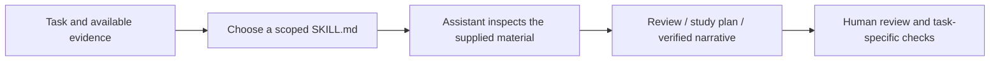

# Claude Engineering Skills
### Small, inspectable workflows for engineering and research

A curated collection of existing instruction-based skills used to structure repository reviews, research questions and evidence-based project narratives.

The value is in explicit inputs, useful decision criteria and honest outputs. These are Markdown workflows for an AI assistant, not an agent framework, model fine-tuning or a benchmarked automation system.

## Catalog

| Skill | Use it for | Inspect |
| --- | --- | --- |
| **Code Project Reviewer** | Understand a repository, prioritize a focused improvement and report checks actually run | [Instructions](skills/code-project-reviewer/SKILL.md) · [Example](examples/repository-review.md) |
| **Research Sparring Partner** | Turn a research claim into a testable study with baselines and validity checks | [Instructions](skills/research-sparring-partner/SKILL.md) · [Example](examples/research-design.md) |
| **Job Story Coach** | Present verified technical experience without inflating ownership or outcomes | [Instructions](skills/job-story-coach/SKILL.md) · [Example](examples/contribution-story.md) |

The first two support technical work. Job Story Coach is a companion workflow for communicating the evidence that work produces.

## How the collection works



A skill does not add tools or permissions. It relies on the host assistant's capabilities and the user's authorized scope. Reading a workflow never authorizes publishing code, accessing accounts or changing external systems.

## Use a skill

Read the selected `SKILL.md` and provide the task and relevant evidence to your assistant. For example:

> Use Code Project Reviewer to review this repository. Focus on documentation and reproducibility. Make no code changes. Distinguish checks you ran from checks you only recommend.

For a Claude Code project that supports project skills, place the selected skill directory under `.claude/skills/` in that project. The directory should contain its `SKILL.md`. Check the discovery/invocation behavior of your installed client; this collection does not include an installer or require a global configuration change.

## Examples and evaluation

[examples/](examples/) contains **illustrative inputs and acceptance criteria**, not fabricated transcripts or reported model results.

[evals/cases.md](evals/cases.md) defines three small manual evaluation cases. [Evaluation status](evals/STATUS.md) distinguishes structural checks from behavioral results. No success rate, model-quality score or unattended reliability is claimed.

## Provenance and scope

The three skills were curated from existing local skill files and packaged together for inspection. Their instruction text is preserved; this repository adds a catalog, examples and evaluation criteria.

Only the selected generic workflows are included. The collection excludes private project context, personal memory, account configuration, employer material and vendor-provided system skills. See [PROVENANCE.md](PROVENANCE.md).

## Layout

```text
skills/       Existing skill instructions
examples/     Synthetic example requests and acceptance criteria
evals/        Manual cases and explicit evaluation status
```
